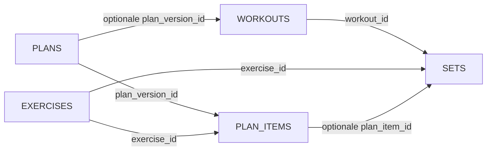

# Arnold Data Contract v1

## Auftrag und geprüfte Quellen

Task 001 implementiert die **Datenzugriffsschicht** für `schema_id = arnold.training_raw`, `schema_version = 1.0.0`. Das neue Modell ist unabhängig vom bisherigen Push/Pull/Legs-Demo-Modell. Dashboard, bestehende MCP-Tools, bisherige Berechnungen und Laufzeitkonfiguration werden dadurch nicht migriert.

Verbindliche Quellen, ausschließlich lesend geprüft am 25.10.2026:

- [Arnold Master](https://docs.google.com/spreadsheets/d/1KMhPGrJSTZYRY5zKpVF3-Zc0tRdCZBV5zez46cJBzcc/edit)
- [Technischer Vertrag, Version 1.0.0](https://drive.google.com/file/d/1BdzmwyoCQMEhLpp6hjeD9NT5FvkHfK6G/view)

Die tatsächlichen sechs Kopfzeilen, CONFIG und alle 25 Katalogeinträge wurden über die vorhandene Drive-Verbindung gelesen. Der abgerufene Stand wurde temporär über einen Replay-Transport durch `ArnoldSheetsReadAdapter` validiert: `MASTER_TEMPLATE`, 25 Übungen, keine Pläne, Planpositionen, Workouts oder Sätze. Die temporäre Datei wurde entfernt; kein echter Katalog wurde als synthetische Testfixture übernommen. Dies prüft die Kompatibilität mit dem tatsächlichen aktuellen Master-Schema, **nicht** die Anmeldung des Backends über eigene Google-Zugangsdaten. Der direkte Google-Transport ist mit Mock-Authentifizierung geprüft.

## Architektur und Verwendung

| Datei                                      | Aufgabe                                                                                          |
| ------------------------------------------ | ------------------------------------------------------------------------------------------------ |
| `src/shared/arnold-schema-v1.ts`           | Exakte Kopfzeilen, TypeScript-Typen, Zod-Schemas, Datensatz- und Referenzvalidierung, ID-Indizes |
| `src/server/arnold-sheet-parser.ts`        | Reiner Parser von Tabellenwerten zu validierten, unveränderlichen Records; Fehlerpositionen      |
| `src/server/arnold-sheets-read-adapter.ts` | Begrenzte Google-GET-Abfragen, Read-only-Authentifizierung, Metadaten- und Identitätsprüfungen   |
| `tests/fixtures/arnold-v1.ts`              | Unabhängige Kopfzeilen und vollständig erfundene synthetische Datensätze                         |

```ts
import { ArnoldSheetsReadAdapter } from "../src/server/arnold-sheets-read-adapter.js";
import { indexArnoldDataset } from "../src/shared/arnold-schema-v1.js";

const adapter = new ArnoldSheetsReadAdapter({
  spreadsheetId: authorizedSpreadsheetId, // vom Backend autorisierte Datei
  expectedTrackerId: authorizedTrackerId,
  expectedFileRole: "USER_TRACKER",
  // keyFile optional; verwendet vorhandene Google-Anmeldung/ADC, erzeugt keine
});
const dataset = await adapter.getDataset();
const index = indexArnoldDataset(dataset);
const exercise = index.exercisesById.get(dataset.sets[0]?.exercise_id ?? "");
```

`ArnoldSheetsReadTransport` bietet ausschließlich `get<T>(path, params)`. Der Standardtransport verwendet `google-auth-library`, den Scope `spreadsheets.readonly`, ausschließlich HTTP `GET` und 15 Sekunden Timeout pro Request. Es gibt keine Append-, Update-, Lösch-, Reset- oder Log-Operation. Datei-IDs und erwartete Tracker-IDs sind **kein Authentifizierungsnachweis**; die Auswahl und Autorisierung der Datei bleiben Aufgabe des aufrufenden Backends. Der Adapter registriert keine MCP-Tools und ist nicht an die bestehenden HTTP-Routen angeschlossen.

## Normalisierte TypeScript-Objekte

Alle Spaltennamen bleiben `snake_case` und entsprechen exakt dem Google-Vertrag. Die Sammlungsnamen sind:

```ts
type ArnoldDataset = Readonly<{
  config: ArnoldConfig;
  configEntries: readonly ArnoldConfigEntry[];
  exercises: readonly ArnoldExercise[];
  plans: readonly ArnoldPlanVersion[];
  planItems: readonly ArnoldPlanItem[];
  workouts: readonly ArnoldWorkout[];
  sets: readonly ArnoldSet[];
}>;
```

`config` erlaubt typisierten Zugriff auf die 14 technischen Einstellungen. `configEntries` erhält zusätzlich jede ursprüngliche CONFIG-Zeile einschließlich Beschreibung. Beide Darstellungen werden auf Übereinstimmung geprüft. Keine abgeleitete effektive Last, kein Volumen und keine synthetischen Ergänzungen sind Bestandteil des Datensatzes.

`indexArnoldDataset` liefert `ReadonlyMap`-Indizes für Exercise-, Planversions-, Planpositions-, Workout- und Set-IDs sowie Sätze je Workout. Die Maps dienen lokalen Abfragen; ein Index ist keine dauerhafte Datenhaltung. Records und Arrays des validierten Datensatzes werden zur Laufzeit eingefroren. Ein erneuter Abruf erzeugt einen neuen Snapshot; ältere Snapshots bleiben unverändert.

## Gemeinsame Typregeln

- **ID:** nichtleerer, unverändert übernommener opaker String ohne Rand-Leerzeichen und Steuerzeichen. Keine UUID-Pflicht für kanonische Übungs-IDs. Keine IDs aus Namen, Datum oder Zeilennummer erzeugen.
- **Text:** nichtleerer String; optionale Texte können `null` sein. Texte werden nicht getrimmt, übersetzt oder normalisiert.
- **UTC:** ISO-8601-String mit `Z`; Offset- und lokale Zeitstempel werden zurückgewiesen. `updated_at_utc` darf nicht vor `created_at_utc` liegen.
- **Datum:** echtes Kalenderdatum als `YYYY-MM-DD`-Text. Google-Datumsserien werden für diesen Vertrag nicht interpretiert. Das lokale Workout-Datum wird nicht aus einem UTC-Zeitstempel neu berechnet.
- **Integer ≥ 1 / ≥ 0:** sicher darstellbare ganze Zahl. Keine booleschen Zahlen, Teilstrings, Hexwerte oder `NaN`/`Infinity`.
- **kg:** endliche Zahl ≥ 0. Keine Rundung und keine Multiplikation beim Lesen. JavaScript/Google-Zahlen unterliegen IEEE-754; es wird keine beliebige Dezimalpräzision versprochen.
- **Leere optionale Werte:** fehlende Zelle, `null` und `""` werden zu `null`. **0 bleibt 0.** Fehlende Pflichtwerte werden zurückgewiesen; es werden keine Standardwerte geraten. Reine Leerzeichen sind kein gültiger nichtleerer Text.
- Native Zahlen sowie eindeutige dezimale Zahlentexte einschließlich Exponent werden akzeptiert. Dezimalkomma wird nicht geraten; der API-Read liefert unformatierte native Werte.
- **Alle aufgeführten Spalten sind Pflichtspalten**, auch wenn die einzelnen Werte optional sind. Reihenfolge und Schreibweise der Kopfzeilen müssen exakt stimmen. Unbekannte Spalten bzw. Daten außerhalb der definierten Spalten werden zurückgewiesen; zusätzliche leere Grid-Spalten sind erlaubt.

## CONFIG

Spalten in Reihenfolge: `key`, `value`, `description`. `key` und `value` sind Pflichttexte; `description` ist Text oder `null`. Doppelte, fehlende und unbekannte Schlüssel werden zurückgewiesen.

| Schlüssel               | Gültiger Wert                                                  |
| ----------------------- | -------------------------------------------------------------- |
| `schema_id`             | `arnold.training_raw`                                          |
| `schema_version`        | `1.0.0`                                                        |
| `template_version`      | Versionsstring `x.y.z`                                         |
| `file_role`             | `MASTER_TEMPLATE` oder `USER_TRACKER`                          |
| `tracker_id`            | ID; `TEMPLATE_UNASSIGNED` ausschließlich bei `MASTER_TEMPLATE` |
| `unit_mass`             | `kg`                                                           |
| `date_storage`          | `ISO-8601`                                                     |
| `raw_data_policy`       | `NO_CALCULATED_COLUMNS`                                        |
| `onboarding_storage`    | `BACKEND_ONLY`                                                 |
| `plan_history`          | `IMMUTABLE_VERSION_IDS`                                        |
| `write_policy`          | `MCP_BACKEND_ONLY`                                             |
| `master_data_policy`    | `NO_REAL_USER_DATA`                                            |
| `deleted_record_policy` | `TOMBSTONE`                                                    |
| `schema_fingerprint`    | `CONFIG\|EXERCISES\|PLANS\|PLAN_ITEMS\|WORKOUTS\|SETS`         |

Der Fingerprint ist der vom Master definierte Tabnamen-Marker, **kein kryptografischer Header-Hash**. Die tatsächlichen Kopfzeilen werden separat geprüft. Eine Master-Vorlage darf Katalogeinträge, aber keine Pläne, Planpositionen, Workouts oder Sätze enthalten. `USER_TRACKER` benötigt eine eigene Tracker-ID.

## EXERCISES

| Spalte, in Reihenfolge    | Typ / Wert                                             |
| ------------------------- | ------------------------------------------------------ |
| `exercise_id`             | ID, Primärschlüssel                                    |
| `name_de`                 | Text                                                   |
| `name_en`                 | Text oder `null`                                       |
| `family_key`              | Freier Text zur Gruppierung, keine Leistungsäquivalenz |
| `variant_key`             | Text                                                   |
| `equipment`               | Text                                                   |
| `primary_muscle`          | Text                                                   |
| `default_load_basis`      | Lastdefinition, siehe unten                            |
| `default_execution_mode`  | Ausführungsart, siehe unten                            |
| `default_implement_count` | Integer ≥ 1                                            |
| `status`                  | `active`, `retired`                                    |
| `created_at_utc`          | UTC                                                    |
| `updated_at_utc`          | UTC                                                    |
| `row_revision`            | Integer ≥ 1                                            |

Übungen besitzen keinen Pflicht-Split. Defaults sind Vorschläge für spätere Eingaben und überschreiben niemals tatsächliche Satzwerte. Retired-Einträge bleiben gültige historische Referenzen.

## PLANS

| Spalte, in Reihenfolge | Typ / Wert                                        |
| ---------------------- | ------------------------------------------------- |
| `plan_version_id`      | ID, Primärschlüssel einer konkreten Version       |
| `plan_family_id`       | ID der Versionsfamilie                            |
| `version_no`           | Integer ≥ 1, innerhalb der Familie eindeutig      |
| `name`                 | Text                                              |
| `split_key`            | Freier Text oder `null`; kein Push/Pull/Legs-Enum |
| `status`               | `draft`, `active`, `archived`                     |
| `goal_key`             | Text oder `null`                                  |
| `days_per_week`        | Integer 1–7 oder `null`                           |
| `activated_at_utc`     | UTC oder `null`                                   |
| `retired_at_utc`       | UTC oder `null`                                   |
| `created_at_utc`       | UTC                                               |
| `updated_at_utc`       | UTC                                               |
| `row_revision`         | Integer ≥ 1                                       |

Es ist höchstens eine aktive Planversion erlaubt. Archivierte und Entwurfsversionen bleiben vollständig erhalten. Vorhandene Aktivierungs-/Archivierungsdaten werden auf zeitliche Reihenfolge geprüft. Versionsnummern dürfen im gelesenen Bestand Lücken haben; der Adapter rekonstruiert keine verlorenen Versionen und kann aus einem einzelnen Read keine historische Versionsfolge beweisen.

## PLAN_ITEMS

| Spalte, in Reihenfolge   | Typ / Wert                                                |
| ------------------------ | --------------------------------------------------------- |
| `plan_item_id`           | ID, Primärschlüssel                                       |
| `plan_version_id`        | ID → PLANS                                                |
| `session_id`             | ID, Session innerhalb der Planversion                     |
| `session_order`          | Integer ≥ 1                                               |
| `session_name`           | Text                                                      |
| `exercise_id`            | ID → EXERCISES                                            |
| `exercise_order`         | Integer ≥ 1                                               |
| `target_sets`            | Integer ≥ 1 oder `null`                                   |
| `rep_min`                | Integer ≥ 0 oder `null`                                   |
| `rep_max`                | Integer ≥ 0 oder `null`; falls beide gesetzt: ≥ `rep_min` |
| `target_load_kg`         | kg oder `null`                                            |
| `target_load_basis`      | Lastdefinition oder `null`                                |
| `target_execution_mode`  | Ausführungsart oder `null`                                |
| `target_implement_count` | Integer ≥ 1 oder `null`                                   |
| `rest_seconds`           | Integer ≥ 0 oder `null`                                   |
| `notes`                  | Text oder `null`                                          |
| `status`                 | `active`, `removed`                                       |
| `row_revision`           | Integer ≥ 1                                               |

Mehrere Übungspositionen dürfen dieselbe Session-ID verwenden. Session-Identität ist das Paar `(plan_version_id, session_id)`; Name und Session-Reihenfolge müssen innerhalb dieses Paars übereinstimmen. Gleiche Session-Namen in verschiedenen Sessions/Versionen sind erlaubt. Zielwerte sind nullable Empfehlungen und werden nicht als tatsächlich ausgeführte Sätze behandelt.

## WORKOUTS

| Spalte, in Reihenfolge  | Typ / Wert                                                          |
| ----------------------- | ------------------------------------------------------------------- |
| `workout_id`            | ID, eigenständiger Primärschlüssel                                  |
| `workout_date_local`    | Datumstext                                                          |
| `timezone`              | Von `Intl.DateTimeFormat` unterstützte Zeitzone, einschließlich UTC |
| `started_at_utc`        | UTC oder `null`                                                     |
| `ended_at_utc`          | UTC oder `null`; bei vorhandenem Start nicht davor                  |
| `plan_version_id`       | ID → PLANS oder `null`                                              |
| `session_id`            | Session der referenzierten Planversion oder `null`                  |
| `session_name_snapshot` | Historischer Text oder `null`                                       |
| `status`                | `planned`, `in_progress`, `completed`, `cancelled`, `voided`        |
| `source`                | `chat`, `ui`, `manual_import`, `sync`                               |
| `notes`                 | Text oder `null`                                                    |
| `created_at_utc`        | UTC                                                                 |
| `updated_at_utc`        | UTC                                                                 |
| `row_revision`          | Integer ≥ 1                                                         |

Ein Workout benötigt weder aktiven Plan noch Sätze. Zwei Workouts am gleichen Tag sind zwei eigenständige Records. Eine Session-ID ohne passende Planversion ist ungültig. Beziehungen zu archivierten Planversionen bleiben bestehen. Der Leser entfernt keine cancelled/voided Records; Filter für spätere Analysen gehören in eine eigene Schicht.

## SETS

| Spalte, in Reihenfolge   | Typ / Wert                                                                            |
| ------------------------ | ------------------------------------------------------------------------------------- |
| `set_id`                 | ID, Primärschlüssel                                                                   |
| `workout_id`             | ID → WORKOUTS                                                                         |
| `exercise_id`            | ID → EXERCISES                                                                        |
| `plan_item_id`           | ID → PLAN_ITEMS oder `null`                                                           |
| `exercise_name_snapshot` | Historischer Pflichttext                                                              |
| `exercise_order`         | Integer ≥ 1 innerhalb der tatsächlichen Einheit                                       |
| `set_number`             | Integer ≥ 1                                                                           |
| `set_type`               | `warmup`, `working`, `drop`, `failure`, `other`                                       |
| `reps`                   | Integer ≥ 0; auch ein Versuch mit 0 bleibt erhalten                                   |
| `reps_basis`             | `total`, `per_side`                                                                   |
| `load_kg`                | kg; bei `bodyweight_only` ausschließlich 0 oder `null`                                |
| `load_basis`             | `total`, `per_implement`, `machine_display`, `added`, `assistance`, `bodyweight_only` |
| `implement_count`        | Integer ≥ 1; fehlender Wert wird nicht auf 1 geraten                                  |
| `execution_mode`         | `bilateral_simultaneous`, `unilateral`, `alternating`                                 |
| `side`                   | `both`, `left`, `right`, `alternating`                                                |
| `rpe`                    | Zahl 1–10 oder `null`                                                                 |
| `rir`                    | Integer ≥ 0 oder `null`                                                               |
| `notes`                  | Text oder `null`                                                                      |
| `status`                 | `active`, `voided`                                                                    |
| `source`                 | `chat`, `ui`, `manual_import`, `sync`                                                 |
| `created_at_utc`         | UTC                                                                                   |
| `updated_at_utc`         | UTC                                                                                   |
| `row_revision`           | Integer ≥ 1                                                                           |

### Last- und Ausführungsdefinitionen

- `total`: eingegebene Gesamtlast; 70 kg bleibt 70 kg.
- `per_implement`: Gewicht je Gerät/Hantel; 20 kg × 2 Hanteln bleibt **20**, Basis `per_implement`, Anzahl 2.
- `machine_display`: Maschinenanzeige, kein automatisch vergleichbarer Freihantelwert.
- `added`: Zusatzlast; ohne Körpergewicht keine angenommene absolute Last.
- `assistance`: positive Unterstützungslast; kein negatives Trainingsgewicht.
- `bodyweight_only`: Last bleibt 0 bzw. `null`; kein erfundenes Körpergewicht.

`bilateral_simultaneous` verlangt `side=both`; `unilateral` verlangt `left` oder `right`; `alternating` verlangt `side=alternating`. `reps_basis` bleibt ausdrücklich gespeichert. Zwei asymmetrische Seiten dürfen dieselbe Satznummer, aber müssen unterschiedliche Set-IDs besitzen. Keine Verdoppelung von Wiederholungen oder Last durch den Parser. Der Vertrag enthält bewusst keine global vergleichbare Gesamttonnage.

## Beziehungen, Eindeutigkeit und Historie



Primär-IDs müssen innerhalb ihrer Tabelle eindeutig sein. Jede Referenz wird validiert, auch bei archivierten, retired oder voided Records. Fehlende Ziel-IDs blockieren den gesamten Datensatz; sie werden nicht geraten oder durch Katalog-Defaults ersetzt. Ein gesetztes `SETS.plan_item_id` muss zur Planversion des Workouts, zu dessen gesetzter Session-ID und zur tatsächlich ausgeführten Übung passen. Für eine spontane Alternative wird `plan_item_id=null` verwendet.

Die Kombination `(workout_id, exercise_id, set_number, side, set_type)` ist für aktive Sätze eindeutig. Tombstones bleiben erhalten und können eine historische Korrektur dokumentieren. Der Adapter filtert oder sortiert physische Speicherbereiche nicht. Plan- und Übungssnapshots werden beim Lesen nicht nachträglich umbenannt.

Eine spätere Planänderung muss eine neue Planversion mit neuen Planpositionen erzeugen; historische Workouts behalten ihre IDs und Planzuordnung. Der Leser kann Integrität des aktuellen Zustands und Unveränderlichkeit seines zurückgegebenen Snapshots prüfen. Er kann ohne externes Journal **keine bereits erfolgte Änderung oder Löschung in Google Sheets beweisen**.

## Fehler und Lesegrenzen

`ArnoldDataError.issues` enthält `code`, optional `table`, `row`, `column` sowie `message`. Zeilen sind echte 1-basierte Tabellenzeilen, auch nach Leerzeilen. Bei Datenfehlern wird kein Teildatensatz ausgegeben. Meldungen kopieren keine Zellwerte oder geheimen Inhalte. Maximal 100 Issues erscheinen in einem Fehler.

`ArnoldSheetsReadError` unterscheidet `AUTH` (401), `PERMISSION` (403), `NOT_FOUND` (404), `RATE_LIMIT` (429), `UNAVAILABLE` (5xx) und `API` (sonstige Netzwerk-/Authentifizierungsfehler). Originalfehler, Header, Tokens und Credential-Inhalte werden nicht als `cause` oder Log weitergereicht. Keine automatischen Retries, Schreibversuche oder Fixture-Fallbacks.

Vor jedem Abruf werden Datei-ID, genau sechs Tabs in der Vertragsreihenfolge, eindeutige Tab-IDs, Grid-Größe und fehlende Merges geprüft. Anschließend werden alle sechs Bereiche ab A1 ausschließlich über GET gelesen. Defaults: höchstens 10.000 Grid-Zeilen und 64 Grid-Spalten je Tabelle, zusätzlich höchstens 1.000.000 Zellen je Tabelle; Optionen können Zeilen bis 100.000 gezielt erlauben. Überschreitungen stoppen den Read statt Daten abzuschneiden. Zusätzliche leere Grid-Spalten sind erlaubt; nichtleere unbekannte Spalten nicht.

`valueRenderOption=FORMULA` legt [Formeln offen](https://developers.google.com/workspace/sheets/api/reference/rest/v4/ValueRenderOption) statt berechnete Werte als Rohdaten zu übernehmen. Die [Values-GET-API](https://developers.google.com/workspace/sheets/api/reference/rest/v4/spreadsheets.values/get) benötigt keinen Request-Body und unterstützt den verwendeten Read-only-Scope. Der Parser verwirft Zellen mit führendem `=`. Die Values-API unterscheidet dabei nicht sicher zwischen Formel und einem gleich aussehenden Literaltext; auch ein Literaltext mit führendem `=` wird konservativ zurückgewiesen. Eine spätere Erweiterung kann `userEnteredValue` gezielt auswerten.

Gleichzeitige `getDataset`-Aufrufe teilen nur den laufenden Read. Der folgende Aufruf liest Google erneut. Es gibt keinen persistenten Trainingsdaten-Cache. Ein Read umfasst Metadaten plus sechs einzelne Bereichsabfragen und ist **kein transaktionaler Snapshot** gegenüber parallelen externen Änderungen. Referenzprüfung kann dabei Widersprüche erkennen, aber keine vollständige Snapshot-Isolation zusichern.

## Kompatibilität und bewusste Grenzen von Task 001

Der alte `GoogleSheetsStorageAdapter` und `parseTrainingSheet` bleiben für den bisherigen Trainingslog erhalten. `StorageAdapter`, Demo-Schemas, Push/Pull/Legs-Berechnungen, UI, bestehende MCP-Tools und `storage-config.ts` sind unverändert. Der neue `ArnoldSheetsReadAdapter` wird explizit als separate Datenquelle instanziiert und liefert kein altes Dashboard-Snapshot. Es gibt keine Fake-Splits oder automatische Migration der alten Tabelle.

Synthetische Tests decken alle sechs Tabellen, leere Historien, Header-/Schemafehler, IDs, Referenzen, Planversionen, archivierte Pläne, freie Workouts, Seiten/Lastdefinitionen, optionale Felder, Zahlen/Enums/Datumswerte, API-Fehler, unveränderliche Snapshots und reine GET-Operationen ab. Fixtures benötigen keine Google-Zugangsdaten. Der reale Master wurde zusätzlich über einen lesenden Connector-Snapshot mit demselben Adapter validiert; dessen fehlende Trainingslogs können naturgemäß keine realen Workout-Beziehungen belegen.

## Tatsächliche Prüfergebnisse für Task 001

Ausgangsstand: sauberer Branch `main`, Commit `406c660d727b6b13eb0cef4a05b6a49eeff3635a`. Es gab keine uncommitteten Änderungen zu sichern. Die Arbeit liegt auf `feat/arnold-data-foundation`.

| Prüfung         | Vor Umsetzung erneut ausgeführt | Abschlussprüfung             |
| --------------- | ------------------------------- | ---------------------------- |
| Typecheck       | bestanden                       | bestanden                    |
| Build           | bestanden                       | bestanden                    |
| Unit-/MCP-Tests | 30 bestanden, 4 Testdateien     | 127 bestanden, 7 Testdateien |
| Playwright      | 9 bestanden                     | 9 bestanden                  |
| Formatprüfung   | bestanden                       | bestanden                    |

Damit sind 97 neue automatisierte Testfälle ergänzt; alle 39 bisherigen Tests bestehen weiterhin. Hinzu kommt die erfolgreiche Schema-Prüfung des tatsächlichen Master-Stands über den lesenden Connector-Replay. Die Änderungszeit der Master-Datei war vor und nach der Prüfung identisch. Keine Schreib-, Share-, Copy- oder Credential-Erzeugungsoperation wurde im Rahmen von Task 001 aufgerufen. Es gibt keinen direkten Backend-Live-Test mit Google-Zugangsdaten; der Standardtransport wurde mit Mock-Authentifizierung getestet.

## Vor produktiven Schreibzugriffen noch erforderlich

Separat beauftragte Folgeschritte sind Nutzerautorisierung und geschützte Tokenablage, Provisionierung in **Nutzerkopien**, versionierte ID-Erzeugung, Planbestätigung, Idempotenzjournal außerhalb Sheets, per-Tracker-Schreibkoordination, erwartete `row_revision`, eng begrenzte Writes, Readback/Reconciliation, Tombstone-/Audit-/Recovery-Regeln und Migrationen. Der aktuelle Adapter erzeugt weder Google-Dateien noch Tokens, verändert keine Master-/Altdatei und richtet kein Deployment oder Tunnel ein. Dashboard-Migration und neue Metriken sind eine nachfolgende Entwicklungsphase.
