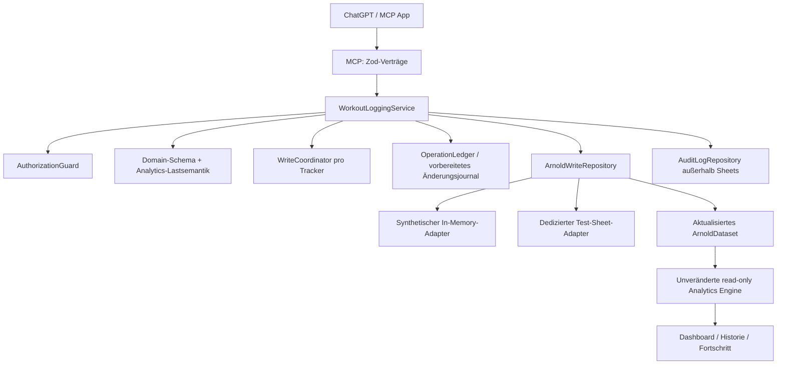

# Arnold Write Contract — Task 004

Stand: S001, 27.10.2026. Rohdatenschema **arnold.training_raw / 1.0.0** bleibt unverändert.
Die sechs Tabellen und ihre Spalten entsprechen dem
[Data Contract](ARNOLD-DATA-CONTRACT.md), die Auswertung dem
[Metrics Spec](ARNOLD-METRICS-SPEC.md). Der Agent-Vertrag wurde aus dem verlinkten
[Arnold SKILL.md](https://drive.google.com/file/d/1BdzmwyoCQMEhLpp6hjeD9NT5FvkHfK6G/view)
gelesen und nicht verändert.

## Architektur und Verantwortlichkeiten



- `src/shared/workout-contract.ts`: ausführbare Input-, Output- und Leseschemas.
- `src/server/workout/service.ts`: Fachregeln, Autorisierung, Status und Revisionen.
  `workout/commit.ts` ist der gemeinsame Commit-Runner für Logger und Planverwaltung: Koordination, Journal und Verifikation. Keine React-Abhängigkeit.
- `src/server/workout/infrastructure.ts`: austauschbare Repositories, Ledger,
  Audit und Koordinator. PostgreSQL kann diese Schnittstellen später implementieren.
- `src/server/arnold-sheets-write-adapter.ts`: begrenzte Sheets-Batches, keine
  öffentlich durchreichbaren Zellbereiche. CONFIG, PLANS und PLAN_ITEMS werden
  nur gelesen und geprüft.
- `src/server/mcp-workout.ts`: schmale Tool-Registrierung und Ergebnisabbildung.
- UI-Client/Hook: Request-Lebenszyklus; Komponenten verwenden keine Google API.

## Betriebsmodi und Berechtigungen

| Modus                 | Verhalten                                                                                                                                                                                                                                              |
| --------------------- | ------------------------------------------------------------------------------------------------------------------------------------------------------------------------------------------------------------------------------------------------------ |
| `disabled` (Standard) | Keine Arnold-Schreibtools registriert. Direkte Service-Aufrufe werden ebenfalls abgelehnt. Vorhandene Demo-/Lesemodi bleiben erhalten.                                                                                                                 |
| `fixture`             | Nur zusammen mit `STORAGE_MODE=arnold_fixture`. Isoliertes synthetisches Repository, ausdrücklich technischer Fixture-Akteur, keine simulierte echte Nutzeridentität.                                                                                  |
| `test_sheet`          | Nur programmatisch injizierte Runtime; Environment-Konfiguration allein wird abgelehnt. Separate Datei-ID, Freigabe, Tracker-ID, private Verbindung, Service-Guard und auf jedem Adapter-Dispatch ein geprüfter authentifizierter Akteur erforderlich. |
| `production`          | Für Task 004 ausnahmslos gesperrt, sowohl im Environment-Resolver als auch im Service-Konstruktor.                                                                                                                                                     |

Start des synthetischen Loggers:

```bash
npm run build
STORAGE_MODE=arnold_fixture ARNOLD_WRITE_MODE=fixture PORT=8795 npm start
```

Die synthetischen Workouts leben im Arbeitsspeicher und werden bei Serverneustart
zurückgesetzt. Browser: `/preview`, MCP-App-Testhost: `/host`.

`AuthorizationGuard.authorize(trackerId, permission, context)` liefert einen
geprüften Akteur. Der Service prüft zusätzlich `verified`, Identität,
Tracker-Zuordnung, Berechtigungen und Akteur-Art. `write` und
`correct_completed` sind getrennte Rechte. Bei echten Test-Sheets muss der
HTTP-Server einen vertrauenswürdigen Request-Authentifizierer erhalten; dessen
Kontext stammt nicht aus Tool-Argumenten. Der Adapter verlangt zusätzlich
`authorizeWrite()` je Dispatch. Ein Boolean ist kein Identitätsnachweis.

Es wird kein OAuth-Flow implementiert. Der optionale Service-Account-Transport
wird nicht aus einer normalen Environment-Konfiguration erzeugt.
`MCP_ACCESS=private` ersetzt keine Nutzeridentität. Echte Verbindungen bleiben an
Loopback und erlaubte lokale Origins gebunden; öffentliche Schreibverbindungen
werden nicht eingerichtet.

## MCP-Verträge

Jedes Schreibtool benötigt `request_id` (nicht leer, maximal 128 Zeichen).
Unbekannte Felder werden abgelehnt. Die typisierten Verträge sind aus Zod
abgeleitet; deren Quelle ist die vollständige verbindliche Definition.

| Tool               | Pflichtfelder zusätzlich zu `request_id`                                                                                                         | Optionale Felder                                                     |
| ------------------ | ------------------------------------------------------------------------------------------------------------------------------------------------ | -------------------------------------------------------------------- |
| `start_workout`    | `workout_date_local`, `timezone`, `session_name`                                                                                                 | `plan_version_id`, `session_id`, `notes`, `started_at_utc`, `source` |
| `log_workout_sets` | `workout_id`, `sets` (1–100)                                                                                                                     | `source`                                                             |
| `update_set`       | `set_id`, `expected_row_revision`, nicht leeres `changes`                                                                                        | `correct_completed`, `correction_reason`                             |
| `void_set`         | `set_id`, `expected_row_revision`                                                                                                                | `correct_completed`, `correction_reason`                             |
| `complete_workout` | `workout_id`, `expected_row_revision`                                                                                                            | `ended_at_utc`                                                       |
| `cancel_workout`   | `workout_id`, `expected_row_revision`                                                                                                            | —                                                                    |
| `create_exercise`  | `name_de`, `family_key`, `variant_key`, `equipment`, `primary_muscle`, `default_load_basis`, `default_execution_mode`, `default_implement_count` | `name_en`                                                            |

`source` ist `chat` oder `ui`, Standard `chat`. Andere Import-/Sync-Quellen
gehören nicht zu diesen Tools. Datumswerte sind echte ISO-Kalenderdaten;
Zeitzonen werden mit `Intl.DateTimeFormat` validiert. Bekannte Startzeiten müssen
zum lokalen Trainingsdatum passen. Bekannte Endzeiten dürfen in der gespeicherten Zeitzone nicht vor dem lokalen Trainingstag liegen und bleiben zusätzlich gegen einen bekannten Start geprüft. Ein Ende am Folgetag und historische Trainings sind erlaubt; explizites `null` und weggelassene Zeitpunkte bleiben unbekannt. Historische Tage sind erlaubt; Start- und
Endzeiten werden nicht für vergangene Tage erfunden.

Ein `sets[]`-Element enthält:

| Feld              | Werte/Grenzen                                                                                 |
| ----------------- | --------------------------------------------------------------------------------------------- |
| `exercise_id`     | Stabile aktive Katalog-ID                                                                     |
| `set_type`        | `warmup`, `working`, `drop`, `failure`, `other`                                               |
| `reps`            | Ganze Zahl ≥ 0                                                                                |
| `reps_basis`      | `total`, `per_side`                                                                           |
| `load_kg`         | Zahl ≥ 0; `null` nur für `bodyweight_only`                                                    |
| `load_basis`      | `total`, `per_implement`, `machine_display`, `added`, `assistance`, `bodyweight_only`         |
| `implement_count` | Ganze Zahl ≥ 1; bei unilateral genau 1, alternierend höchstens 2                              |
| `execution_mode`  | `bilateral_simultaneous`, `unilateral`, `alternating`                                         |
| `side`            | Passend zur Ausführung: `both`, `left`/`right`, `alternating`                                 |
| Optional          | `plan_item_id`, `set_number`, `exercise_order`, `rpe` (1–10), `rir` (ganzzahlig ≥ 0), `notes` |

`update_set.changes` erlaubt ausschließlich diese Mess-/Ausführungsfelder und
Notizen, keine IDs, Referenzen, Snapshot-Namen, Satznummern oder Erstellungsdaten.
`rpe`, `rir` und `notes` können mit `null` geleert werden.

Jede Antwort enthält im `structuredContent`:

```ts
{
  ok: boolean,
  operation: WriteOperation,
  request_id: string,
  replayed: boolean,
  result: null | {
    workout: ArnoldWorkout | null, sets: ArnoldSet[],
    exercise: ArnoldExercise | null, warnings: string[]
  },
  error: null | { code: WriteErrorCode, message: string, retryable: boolean, recovery?: "none" | "retry_same_request" | "retry_or_new_request", details: string[] }
}
```

Erfolg enthält `result` und keinen Fehler; Fehler enthalten `error` und kein
Erfolgsergebnis. Erzeugte/aktualisierte Rohdatensätze liefern ihre stabilen IDs und
`row_revision`. Kein vollständiges Dashboard wird im Write-Ergebnis mitgeliefert.
Alle Schreibtools sind als nicht lesend und idempotent annotiert. Korrektur,
Stornierung und Abbruch tragen den Destructive-Hinweis für ihre fachliche Wirkung.

Fehlercodes: `VALIDATION_ERROR`, `EXERCISE_NOT_FOUND`, `WORKOUT_NOT_FOUND`,
`SET_NOT_FOUND`, `INVALID_STATUS_TRANSITION`, `REVISION_CONFLICT`,
`DUPLICATE_OPERATION`, `SCHEMA_MISMATCH`, `TEMPLATE_WRITE_FORBIDDEN`,
`AUTH_REQUIRED`, `PERMISSION_DENIED`, `STORAGE_UNAVAILABLE`,
`COMMIT_STATUS_UNKNOWN`, `EXERCISE_MATCH_FOUND`.

Ungültige skalare Tool-Argumente kann bereits die MCP-SDK-Eingabevalidierung als
Protokoll-/Toolfehler ablehnen. Fachliche Fehler aus dem Service liefern die
obigen strukturierten Codes und `isError=true`. Interne Ausnahmebeschreibungen
und Zugangsdaten werden nicht ausgegeben.

`get_workout({ workout_id? })` ist lesend und liefert den gezielt gewählten
Workout-Datensatz, dessen Sätze, offene Workouts, aktiven Übungskatalog, Pläne,
Planpositionen, `tracker_id`, `write_mode`, `can_write` und
`can_correct_completed`. Das Tool ist auch in `disabled` verfügbar. Ein Read
allein bestätigt keinen unklaren Commit; dafür die ursprüngliche Operation mit
demselben Payload erneut ausführen.

## Domain-Regeln, Status und historische Referenzen

Neue Workouts beginnen mit `in_progress`. Ein eindeutig passender Session-Name
kann dem aktiven Plan zugeordnet werden; bei keiner/einer mehrdeutigen Zuordnung
entsteht ein freies Workout. Ein erst nach dem Trainingstag aktivierter Plan wird nicht automatisch angehängt. Explizite Plan-/Session-Referenzen werden überprüft.
Entwürfe sind noch keine verwendbaren Trainingsplanversionen. Archivierte
Versionen dürfen für historisch erfasste Workouts referenziert werden.

| Ausgang               | Erlaubte Änderung                                                                                                             |
| --------------------- | ----------------------------------------------------------------------------------------------------------------------------- |
| Kein Workout          | `start_workout` → `in_progress`                                                                                               |
| `planned`             | `cancel_workout` → `cancelled`                                                                                                |
| `in_progress`         | Sätze speichern/korrigieren/stornieren; Abschluss → `completed`; Abbruch → `cancelled`                                        |
| `completed`           | Nur explizite Satzkorrektur/-stornierung mit `correct_completed=true`, nicht leerer `correction_reason` und gesondertem Recht |
| `cancelled`, `voided` | Keine weitere Mutation durch Task-004-Tools                                                                                   |

Es gibt keine stille Wiederöffnung. `planned -> in_progress` und Wiederaufnahme
bleiben spätere explizite Erweiterungen. Abschluss verlangt mindestens einen
aktiven Satz mit Wiederholungen. Abbruch erhält sämtliche Sätze.

Sätze: Anlage `active`; Korrektur bleibt `active`; Stornierung `active -> voided`.
Keine physische Löschung und keine Reaktivierung. Identische Wiederholungen
werden über ihre Operations-ID beantwortet; eine neue ID erzwingt keine erneut
unzulässige Statusänderung.

Satznummern laufen je Workout, Übung, Seite und Satztyp. Links/rechts können
dieselbe Satznummer mit unterschiedlichen IDs haben. Bereits verwendete Nummern
stornierter Sätze werden bei automatischer Vergabe nicht wiederverwendet.
Übungsreihenfolge ist innerhalb der tatsächlichen Einheit konsistent.

Planpositionen müssen zu Planversion, Session und Übung gehören. Spontane Sätze
benötigen keine Planposition. Snapshot-Namen, ursprüngliche Referenzen und IDs
bleiben bei Korrekturen geschützt. Die Adapter-Validierung verhindert auch
entsprechende interne Umwidmungsversuche. Neue Übungen erzeugen keinen Plan-Edit;
mögliche Dubletten werden vor der Anlage zurückgegeben.

## Lasten und Wiederholungen

Der Service verwendet das vorhandene `ArnoldSetSchema` und
`analyzeSetLoad` aus Task 002. Er lehnt die dort als mehrdeutig bewertete
Kombination `bilateral_simultaneous + reps_basis=per_side` ab.
Alternierende Gesamtwiederholungen bleiben gültige Rohdaten, auch wenn daraus
kein eindeutiges 1RM pro Seite abgeleitet werden kann.

Tatsächliche Gewichte werden unverändert gespeichert. Zwei gleichzeitig bewegte
20-kg-Hanteln bleiben `load_kg=20, per_implement, implement_count=2`;
Berechnungen entstehen ausschließlich in Analytics. Körpergewicht erlaubt
`null` oder `0`; Unterstützung benötigt positive kg. RPE/RIR werden nicht geraten.
Ungewöhnliche Lasten über 500 kg oder Wiederholungszahlen über 100 erzeugen eine
Warnung und werden nicht pauschal verboten. Keine berechneten Volumen-/1RM-Spalten.

## IDs, Revisionen und Audit

Serverseitige UUIDv7 für neue Workout-, Satz- und Übungs-IDs. IDs werden vor dem
Dispatch in einem vorbereiteten Journal gespeichert; Zeilenpositionen sind keine
Identitäten. Neue Datensätze beginnen mit Revision 1, Änderungen verlangen die
aktuelle erwartete Revision und erhöhen sie genau einmal. Erstellungszeit und
IDs bleiben erhalten; die Änderungszeit kommt von der Serveruhr.

`AuditLogRepository.append(events)` muss wiederholte `(operation_id, entity_id,
event_type)` deduplizieren. Die Fixture-Implementierung tut dies. Ereignisse:
`WORKOUT_CREATED`, `WORKOUT_COMPLETED`, `WORKOUT_CANCELLED`, `SET_CREATED`,
`SET_UPDATED`, `SET_VOIDED`, `EXERCISE_CREATED`.

Ereignisse enthalten Akteur, Operations-ID, Entity-ID, Zeitpunkt, alte/neue
Revision, Ergebnis, geänderte Feldnamen, relevante numerische/Enum-Vorher-/Nachher-
Werte und gegebenenfalls die ausdrückliche Korrekturbegründung. Notizinhalte und
Namen werden nicht in den Audit-Änderungswerten dupliziert. Der vorbereitete
Operationsdatensatz enthält notwendige vollständige Vorher-/Nachher-Datensätze
für die Wiederherstellung und gehört in geschützten Backend-Speicher.

## Idempotenz, Wiederanlauf und Koordination

Fingerprint: SHA-256 der kanonischen Kombination aus Operation und validiertem
Payload. Ledger-Schlüssel: Tracker-ID plus Request-ID; Akteur wird ebenfalls
geprüft. Gleiche ID/gleicher Payload gibt das ursprüngliche bestätigte Ergebnis
mit `replayed=true` zurück. Ein später korrigierter Satz wird dabei nicht
zurückgesetzt; aktuelle Werte sind separat mit `get_workout` lesbar.
Gleiche ID/anderer Payload oder Akteur: `DUPLICATE_OPERATION`. Neue ID: eigenständige
fachliche Operation, sofern weiterhin gültig.

Journalzustände im bestehenden JSON-Array-Format (additive S001-Erweiterung):

1. `prepared`: Änderungen, Ergebnis und Audit-Absicht vorbereitet; noch kein Dispatch.
2. `dispatching`: vor Kontakt mit dem Repository dauerhaft gespeichert. Ein unklarer Ausgang bleibt gesperrt.
3. `committed`: Readback, Audit und abschließender Ledger-Eintrag bestätigt.
4. `rejected`: Das Repository hat mit `RejectedWriteError` ausdrücklich bewiesen, dass der Batch nicht dispatcht oder vollständig abgelehnt wurde. Normale Fehlercodes allein sind kein solcher Beweis. Dieser Zustand blockiert keine unabhängigen Aufträge. Derselbe Akteur kann denselben Request wieder aufnehmen; der originale Payload wird gegen die inzwischen aktuellen Revisionen neu validiert. Da noch nichts geschrieben wurde, dürfen dabei neue Entity-IDs entstehen. Unklare Dispatches behalten dagegen ihre ursprünglichen IDs und Änderungen.
5. `abandoned`: Der nachweislich abgelehnte Auftrag wurde unter derselben Tracker-Sperre endgültig geschlossen. Seine Request-ID bleibt an Akteur und Fingerprint gebunden und darf nicht für einen Write wiederverwendet werden.

`abandon_rejected_write({request_id})` ist ein eng begrenztes Journal-Tool, kein Sheets-Write. Nur der ursprüngliche geprüfte Akteur darf einen aktuell `rejected`-Eintrag schließen. Ein paralleler Retry und ein Abbruch serialisieren gegeneinander. Hat der Retry schon wieder dispatcht, wird der Abbruch abgelehnt. Wiederholter bestätigter Abbruch ist idempotent. Die UI löscht erst nach dieser Serverbestätigung ihre Recovery-Daten; ein lokales Verwerfen eines ungeklärten Requests wird nicht angeboten.

Jede aktuelle Service-Fehlerantwort liefert zusätzlich `error.recovery`:

| Wert                   | Bedeutung                                                                                                                                                           |
| ---------------------- | ------------------------------------------------------------------------------------------------------------------------------------------------------------------- |
| `none`                 | Für diesen Request ist keine offene Mutation entstanden oder der Auftrag wurde endgültig geschlossen. Eingaben können korrigiert werden.                            |
| `retry_same_request`   | Payload und ID unverändert behalten und den ursprünglichen Vorgang prüfen. Keine Ersatzmutation erzeugen.                                                           |
| `retry_or_new_request` | Die Ablehnung ist dauerhaft belegt. Derselbe Auftrag kann nach Behebung der Ursache erneut versucht oder mit `abandon_rejected_write` endgültig geschlossen werden. |

`retryable` beschreibt die Fehlerursache, ersetzt dieses Recovery-Signal aber nicht. Historische Payloads ohne das additive Feld werden vom Client vorsichtig als ungeklärt behandelt. Auch ein Auth-/Berechtigungsfehler vor dem erneuten Service-Einstieg erhält `retry_same_request`, wenn ein früherer Intent existiert. Ein bewiesener 401-/403-Reject bleibt durch den Journalzustand wiederaufnehmbar, selbst wenn der unmittelbare Google-Readback wegen derselben Berechtigung scheitert.

Alte Workout- und Plan-Journale werden anhand derselben Zeilen- und Result-Schemas kontrolliert gelesen; sie werden weder verworfen noch als leer ersetzt. Ergebnisse werden zusätzlich mit dem konkreten Domänen-Result-Schema geprüft. Neue Zustände sind für alte Serverversionen unbekannt: keinen alten Server auf ein bereits mit S001 erweitertes Journal zurückrollen. `pending()` umfasst ausschließlich `prepared` und `dispatching`. Ein anderer Akteur darf keinen fremden Pending-Auftrag automatisch abschließen.

Wenn Google bereits geschrieben hat, aber die Ledger-Bestätigung scheitert,
bleibt die vorbereitete Absicht erhalten. Ein Retry liest zuerst dieselben
stabilen IDs und vollständigen erwarteten Werte. Vollständig angewendet → Audit
idempotent ergänzen und Ledger abschließen. Teilweise/fremd verändert →
`COMMIT_STATUS_UNKNOWN`; keine weitere Mutation. Nach einem unsicheren Dispatch
ist auch „aktuell keine Zeile sichtbar“ kein Beweis, dass der Google-Aufruf
niemals mehr committen kann. Daher kein blindes Append-Retry.

Andere ausstehende Operationen werden vor einem neuen Write geprüft. Ungeklärte
Vorgänge sperren den Tracker. Fehlt das Journal vollständig, sind verlorene
zufällige IDs nicht zuverlässig rekonstruierbar: Journal aus Backup wiederherstellen
und manuell abgleichen, niemals mit leerem Ledger einen bestehenden Tracker
weiterbeschreiben. Es wird keine Exactly-once-Garantie behauptet.

`InMemoryOperationLedger` ist nur für synthetische Fixtures.
`FileOperationLedger` überlebt Prozessneustarts durch ein JSON-Journal mit
Dateirechten 0600, Flush, atomarem Rename und serialisierten Writes. Es ist ein
lokaler Ein-Prozess-Adapter, kein verteiltes Ledger und kein vollständiges
Backup-/Disaster-Recovery-System. Eine nach Benutzung verschwundene/beschädigte
Datei wird nicht still als leeres Journal behandelt.

`InProcessWriteCoordinator` serialisiert je Tracker. Alle Services desselben
Trackers müssen denselben Koordinator und dasselbe Ledger verwenden. Die
Schnittstelle sieht eine verteilte Implementierung vor; diese wird nicht
simuliert. Google-Revisionsprüfung allein ist kein Compare-and-Swap. Andere
Prozesse und manuelle Sheets-Änderungen bleiben ohne verteiltes Backend ein
Produktionshindernis.

## Google-Sheets-Mechanismus und Fehler

Vor jedem Batch: explizite Datei-ID, CONFIG mit Schema v1, vollständige sechs
Header-Vektoren, Tabellenreihenfolge, Grenzen, keine verbundenen Zellen,
Referenzen, Tracker-ID und Rollenprüfung durch den bestehenden typisierten
Read-Adapter. Die feste Master-ID wird bereits im Write-Adapter-Konstruktor
gesperrt; `MASTER_TEMPLATE` auch unter einer anderen Datei-ID. Unzugewiesene oder
fremde Tracker werden abgewiesen.

Nur WORKOUTS, SETS, EXERCISES sind beschreibbar. Neuanlagen werden je Tabelle als
`appendCells` gebündelt; gezielte Änderungen als einzelne `updateCells` mit
aktuell per ID ermittelter Zeile und exakt erlaubter Spaltenbreite. Sämtliche
Änderungen einer Operation gehen in **ein** `spreadsheets.batchUpdate`.
Text wird über `ExtendedValue.stringValue`, Zahlen über `numberValue`
geschrieben. Führende `=`, `+`, `-`, `@` werden nicht als Formel ausgewertet.
Nach dem Batch werden die Daten erneut gelesen und die betroffenen IDs/Werte gezielt geprüft. Dafür wird derzeit das vollständige begrenzte Dataset gelesen; dies verursacht zusätzliche Google-Lesezugriffe und ist vor größeren Tracker-Historien zu optimieren.

Die zentralen Standardgrenzen stehen in `src/shared/sheets-limits.ts`: 10.000 physische Grid-Zeilen inklusive Header, 64 Spalten, 1.000.000 Zellen pro Tabelle. Vor jedem Dispatch werden WORKOUTS-, SETS- und EXERCISES-Appends vollständig auf ihre resultierende Größe geprüft. Maßgeblich sind die letzte physische Datenzeile einschließlich interner Lücken, alle Appends des Batches und die vorhandene Grid-Größe. Freie Grid-Zeilen werden berücksichtigt. Ein übergroßer Batch scheitert vollständig mit `VALIDATION_ERROR` und null Write-Batches; historische Zeilen werden nicht gelöscht und Reads nicht abgeschnitten. Der synthetische Transport bildet die Grid-Erweiterung durch Append nach.

Google beschreibt die Batch-Anwendung als atomar, weist aber auf konkurrierende
Änderungen durch andere Bearbeiter hin. Dies umfasst kein externes Ledger oder
Audit. Siehe [batchUpdate](https://developers.google.com/workspace/sheets/api/reference/rest/v4/spreadsheets/batchUpdate),
[AppendCells/UpdateCells](https://developers.google.com/workspace/sheets/api/reference/rest/v4/spreadsheets/request)
und [ExtendedValue](https://developers.google.com/workspace/sheets/api/reference/rest/v4/spreadsheets/other#ExtendedValue).

| Fehler                                    | Behandlung                                                                                    |
| ----------------------------------------- | --------------------------------------------------------------------------------------------- |
| 401 / 403                                 | `AUTH_REQUIRED` / `PERMISSION_DENIED`, keine automatische Wiederholung                        |
| 404                                       | `STORAGE_UNAVAILABLE`, kein Wechsel auf eine andere Datei                                     |
| 400 / Struktur-/Schemafehler              | Vollständig abgelehnter Batch bzw. `SCHEMA_MISMATCH`                                          |
| 429 beim Schreiben                        | Nur bei eindeutigem HTTP-429-Reject maximal drei Versuche, exponentieller Backoff plus Jitter |
| 429 / 5xx beim Lesen                      | Maximal drei sichere Leseversuche                                                             |
| Write-Timeout, Netzwerkabbruch, 5xx       | Keine automatische Write-Wiederholung; IDs und Werte reconciliieren                           |
| Audit-/Ledger-Bestätigung fehlt           | Kein Erfolg, `COMMIT_STATUS_UNKNOWN`, ursprüngliche ID erneut prüfen                          |
| Teilweise oder unerwartet geänderte Daten | Quarantäne, keine weiteren Writes                                                             |

Der Test-Sheet-Adapter erkennt unerwartete Dataset-Prüfsummenänderungen während
seiner Laufzeit. Das ist kein atomarer Schutz gegen Bearbeiter zwischen letzter
Prüfung und Batch. Ein dauerhafter externer Drift-Checkpoint und Reparaturprozess
fehlen noch für den Produktivbetrieb.

## UI und Analytics

Nach bestätigter Speicherung folgen ein gezielter Workout-Read und eine kompakte
Dashboard-Aktualisierung; keine vollständige Historie je Satz. Fehler erhalten
die Formwerte. Ein synchrones Submit-Gate verhindert doppelte Klicks. Unklare
Vorgänge behalten Payload und ID, blockieren weitere Eingaben und bieten
„Vorgang prüfen“. Session Storage hilft im Browser bei Reload; in einer opaken
MCP-App bleibt der Request im gemeinsamen Client über Ansichtswechsel erhalten.
Eine ganz neue Host-Sitzung ohne Speichermöglichkeit verliert diesen lokalen
Entwurf; es wird daraus keine automatische neue Mutation erzeugt.

Der vorhandene historische-Tool-Ergebnis-Guard liest beim Öffnen erneut vom
Server. Die Analytics Engine bleibt unverändert read-only; korrigierte Rohdaten
fließen in neu berechnete PRs/Verläufe, `voided` und `cancelled` folgen den Regeln
aus Task 002. Cache-Invalidierung verwendet eine Generation, sodass ein vor dem
Write gestarteter Read keinen alten Snapshot nachträglich als frisch publiziert.

## Beispielaufrufe

```json
{
  "name": "start_workout",
  "arguments": {
    "request_id": "op-start-1",
    "workout_date_local": "2026-10-26",
    "timezone": "Europe/Berlin",
    "session_name": "Demo Push",
    "source": "ui"
  }
}
```

```json
{
  "name": "log_workout_sets",
  "arguments": {
    "request_id": "op-sets-1",
    "workout_id": "<workout_id>",
    "sets": [
      {
        "exercise_id": "fixture-incline",
        "set_type": "working",
        "reps": 10,
        "reps_basis": "total",
        "load_kg": 20,
        "load_basis": "per_implement",
        "implement_count": 2,
        "execution_mode": "bilateral_simultaneous",
        "side": "both"
      }
    ]
  }
}
```

```json
{
  "name": "update_set",
  "arguments": {
    "request_id": "op-fix-1",
    "set_id": "<set_id>",
    "expected_row_revision": 1,
    "changes": { "load_kg": 22 }
  }
}
```

```json
{
  "name": "complete_workout",
  "arguments": {
    "request_id": "op-done-1",
    "workout_id": "<workout_id>",
    "expected_row_revision": 1
  }
}
```

## Teststrategie und Produktionsfreigabe

Alle Tests verwenden synthetische Daten: Service-/Lifecycle-/Lastregeln,
Idempotenz, parallele Writes, Revisionen, Teilfehler, Response-Verlust,
Ledger-Bestätigungsfehler und lokaler Neustart, Audit, Template-/Tracker-Schutz,
Google-Fehler und Formel-Literale, echte Streamable-HTTP-Integration sowie
Playwright für Preview und sandboxed MCP-App. Es gab keinen echten Sheets-Write.
Tatsächliche Ergebnisse stehen im [Completion Report](ARNOLD-TASK-004-COMPLETION-REPORT.md).

Vor produktiven Writes fehlen: echte Nutzeridentität und Tracker-Eigentum,
passender OAuth-/Token-Speicher, verteiltes transaktionales Ledger und
Koordination, dauerhafter Audit-Speicher, externe Drift-Erkennung über Neustarts,
Backups, Recovery-/Reconciliation-Verfahren und deren Tests. Dafür wurde kein
externer Dienst eingerichtet. Task 007 muss diese Grenzen schließen.

Vorschlag für die Agent-Anleitung: die tatsächlichen Tool-Namen
`log_workout_sets`/`create_exercise`, die zusätzlichen Revisionspflichten bei
Abschluss/Abbruch, den expliziten Korrekturmodus und
`COMMIT_STATUS_UNKNOWN`/Retry-Protokoll aufnehmen. Dies ist ein Vorschlag;
die Drive-Datei bleibt unverändert. Es wird keine Sheet-Schema-Migration benötigt.
